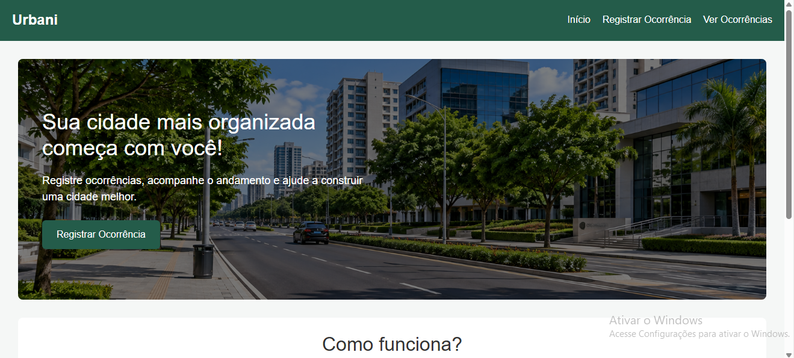
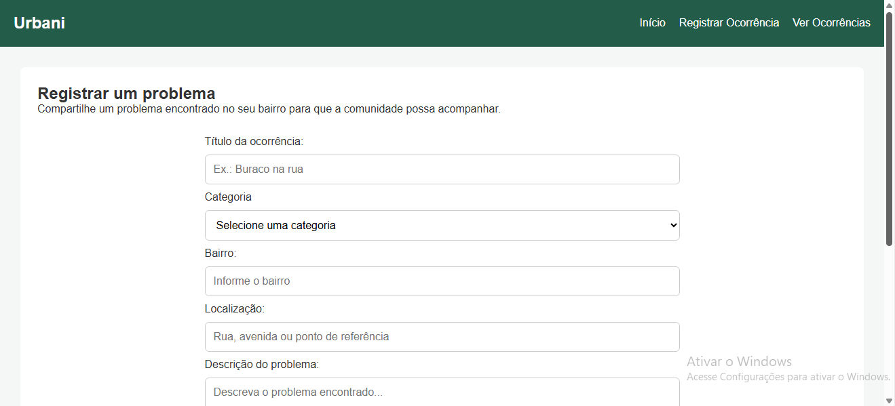
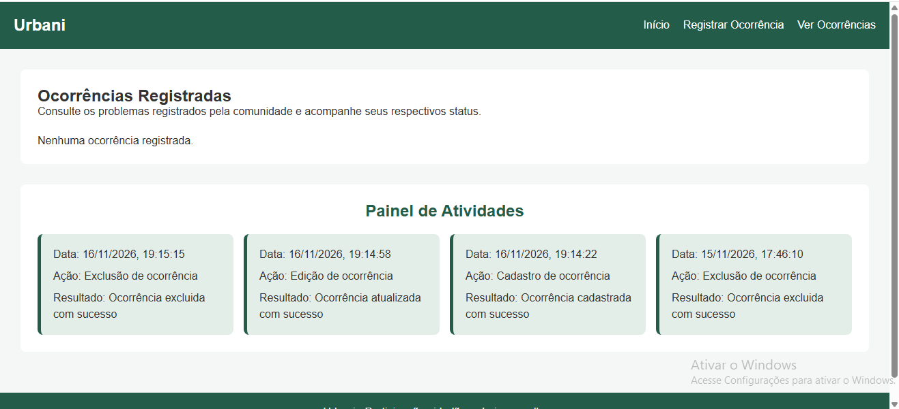

# Urbani

Plataforma comunitária para registro e acompanhamento de problemas urbanos.

## Sobre o projeto

O Urbani é um projeto que busca incentivar a participação dos moradores na identificação e no acompanhamento de problemas presentes em seus bairros.

A plataforma permite registrar, consultar, editar e excluir ocorrências, contribuindo para uma visão coletiva das necessidades da comunidade.

O projeto surgiu da observação de problemas urbanos, como calçadas danificadas, buracos nas vias, iluminação pública inadequada e descarte irregular de resíduos. Essas situações afetam a mobilidade, a segurança e a qualidade de vida dos moradores, especialmente de pessoas com mobilidade reduzida.

O Urbani possui caráter comunitário e não representa um canal oficial de comunicação com a prefeitura ou outros órgãos públicos.

## Objetivo

Incentivar a participação cidadã e facilitar o registro e o acompanhamento comunitário de problemas urbanos, contribuindo para cidades mais organizadas e acessíveis.

O projeto está relacionado principalmente ao **ODS 11 – Cidades e Comunidades Sustentáveis**, além de contribuir com o **ODS 10 – Redução das Desigualdades**.

## Funcionalidades

- Registro de problemas urbanos.
- Consulta de ocorrências cadastradas.
- Edição e exclusão de registros.
- Acompanhamento comunitário dos status das ocorrências.
- Painel de atividades com data, ação e resultado das operações.
- Validação dos campos e exibição de mensagens ao usuário.
- Layout responsivo para diferentes tamanhos de tela.

## Tecnologias utilizadas

- HTML5
- CSS3
- JavaScript
- Bootstrap 5
- LocalStorage

## Estrutura de pastas

```text
Urbani/
├── CSS/
│   └── style.css
├── Imagens/
│   └── banner-urbani.png
├── Js/
│   └── registros.js
├── index.html
├── registrar.html
├── ocorrencias.html
└── README.md
```

## Armazenamento de dados

Os registros e as atividades são armazenados localmente no navegador por meio do LocalStorage.

Isso significa que os dados ficam disponíveis apenas no mesmo navegador e dispositivo em que foram cadastrados, não existindo compartilhamento automático entre diferentes usuários ou dispositivos.

## Como executar

1. Baixe ou clone este repositório.
2. Abra a pasta do projeto no VS Code.
3. Abra o arquivo `index.html` em um navegador.
4. Para facilitar a execução, também é possível utilizar a extensão Live Server do VS Code.

## Capturas de tela

As imagens abaixo devem apresentar as principais telas do projeto:

- Página inicial.
- Formulário de registro de ocorrência.
- Página de consulta de ocorrências e painel de atividades.

### Página inicial


### Registro de ocorrência


### Consulta de ocorrências


## Limitações

- Não possui banco de dados ou servidor.
- Os registros não são enviados à prefeitura.
- Os dados não são sincronizados entre dispositivos.
- O armazenamento depende dos dados locais do navegador.
- Não possui sistema de cadastro ou autenticação de usuários.

## Possibilidades futuras

O projeto poderá evoluir para uma solução de impacto social, com possibilidade de parceria com associações de moradores, organizações sociais e instituições locais, mantendo o acesso gratuito para os cidadãos.

## Status do projeto

Em desenvolvimento.